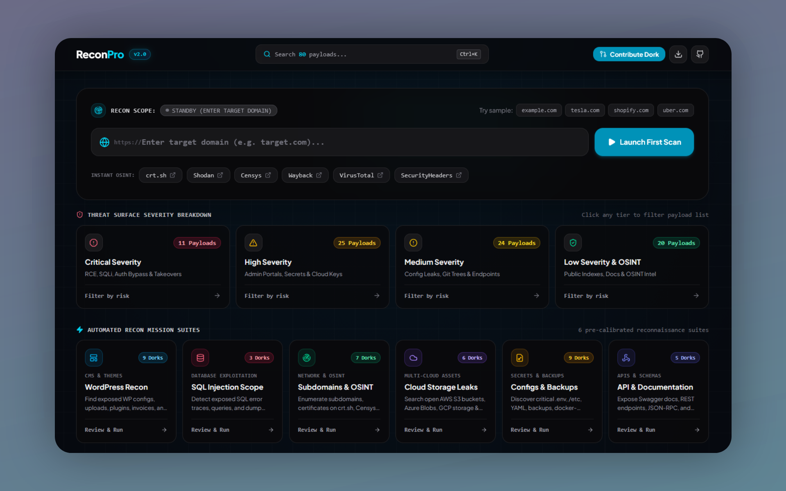

# ReconPro 🔍 - Advanced Bug Bounty & Reconnaissance Suite

[](https://iamshafayat.github.io/ReconPro/)
[](https://github.com/iamshafayat/ReconPro/stargazers)
[](https://github.com/iamshafayat/ReconPro/forks)
[](https://github.com/iamshafayat/ReconPro)
[](https://github.com/iamshafayat/ReconPro)



> 🌐 **Live Tool**: [https://iamshafayat.github.io/ReconPro/](https://iamshafayat.github.io/ReconPro/)

**ReconPro** is a specialized web reconnaissance tool designed for cybersecurity professionals and bug bounty hunters. It provides instant access to carefully curated Google dorks organized by vulnerability type and risk level, significantly accelerating the initial reconnaissance phase of security assessments.

Built with modern React, TypeScript, and Tailwind CSS. Fast, intuitive, and built for modern offensive and defensive security operations.

---

## ⚡ What's New in v2.0

ReconPro v2.0 introduces major enhancements for tactical efficiency, visual clarity, and community contribution:

- 🔮 **Frosted Glassmorphism UI**: High-contrast, dark cyber navigation featuring backdrop blur (`backdrop-blur-xl`), refined glow accents, and responsive layout scaling.
- 🎛️ **Split Studio & Inspector Workspace**: Dual-pane IDE / Burp Suite-inspired workflow with persistent terminal inspector, interactive syntax highlighting, operator pill injection, live cURL command builder, and Nuclei YAML template exporter.
- 🎯 **Targeted Preset Suites**: One-click recon profiles (*Critical Bounty Hunt*, *Cloud Storage & Keys*, *CMS Audits*, *Exposed Backups*, and *OSINT Discovery*) to quickly filter and execute relevant vectors.
- 🔎 **Multi-Engine Execution**: Run queries across Google, Bing, DuckDuckGo, Yahoo, and Yandex to bypass rate limits or find unindexed assets.
- 🤝 **In-App Contribution Wizard**: Interactive modal to draft, validate, and test new payloads in real time, with instant formatted JSON generation for easy GitHub Issue submissions.
- ⌨️ **Command Palette (`Cmd+K` / `/`)**: Fast keyboard-driven navigation across all 80+ categorized payloads.
- 📦 **Multi-Format Export Engine**: Export filtered or selected payloads into Markdown checklists, Bash automation scripts (`.sh`), raw text lists, or structured JSON.

---

## ✨ Features

- 🎯 **80+ High-Impact Payloads**: Comprehensive coverage across file exposure, cloud leaks, SQLi traces, credentials, CMS exploits, and OSINT pivots.
- ⚡ **Interactive Dork Studio & Playground**: Live query syntax highlighting, dynamic operator builder pills, and direct test runs across multiple search engines.
- 🌐 **Instant OSINT Integrations**: One-click jumps to crt.sh, Shodan, Censys, VirusTotal, Wayback Machine, and SecurityHeaders.
- 🤝 **Community-Driven Dorks Database**: Easily propose and contribute new vectors via GitHub Issues.
- 💻 **Multiple View Modes**:
  - **Grid View**: Sleek holographic cards with instant copy, scan, and star actions.
  - **Split Studio View**: IDE / Burp Suite dual-pane layout with persistent terminal inspector, cURL generator, and Nuclei templates.
  - **Matrix Table View**: Compact layout for rapid browsing.
- ⌨️ **Command Palette (`Cmd+K` / `/`)**: Fast keyboard-navigable search across all payloads.
- 📦 **Multi-Format Exporter**: Export payloads as `.txt`, `.md` bug bounty checklists, `.sh` bash scripts, or `.json` schemas.
- 📱 **100% Responsive & Touch-Optimized**: Flawless experience from mobile screens to 4K displays.

---

## 🛠️ Usage Guide

### Basic Flow:
1. **Visit**: [https://iamshafayat.github.io/ReconPro/](https://iamshafayat.github.io/ReconPro/)
2. **Enter Target**: Input your target domain (e.g., `example.com`) in the Recon Scope bar.
3. **Select Dorks**:
   - **Browse all**: Filter payloads by category, severity/risk level, or search keywords.
   - **Use presets**: Select ready-made recon profiles (*WordPress*, *SQLi*, *Subdomains*, *Cloud Leaks*).
4. **Execute**: Click to execute searches in new tabs instantly across your preferred search engines.

---

## 🤝 How to Add New Dorks (Community Contributions)

ReconPro is community-driven! If you are interested in contributing to this tool by adding fresh, high-impact search dorks, you can easily submit them via **GitHub Issues**:

### Method 1: Using the In-App Dork Creator Form (Recommended)
1. Open ReconPro and click **"Contribute Dork"** in the top navigation bar.
2. Fill out the **Dork Creator Form** with your payload details:
   - Vector Name
   - Category (or create a new custom category)
   - Severity Level (`Critical`, `High`, `Medium`, `Low`)
   - Dork Query syntax
   - Threat Objective / Description
3. Test your dork live against any active target with syntax highlighting.
4. Click **"Copy Issue JSON"** to copy the formatted snippet, or click **"Open Issue on GitHub"** to open a new GitHub Issue directly.
5. Paste the snippet or details into the issue description. The maintainer will test and merge it into the tool!

### Method 2: Open an Issue Directly on GitHub
If you prefer to submit directly through GitHub:
1. Go to the repository: [github.com/iamshafayat/ReconPro](https://github.com/iamshafayat/ReconPro).
2. Open a **New Issue** in the Issues tab: [github.com/iamshafayat/ReconPro/issues/new](https://github.com/iamshafayat/ReconPro/issues/new).
3. Provide the details about your dork:
   - **Vector Name** (e.g. `Grafana Dashboards`)
   - **Category** (e.g. `Web Applications`, `Cloud Storage Exposure`, etc.)
   - **Severity** (`Critical`, `High`, `Medium`, `Low`)
   - **Dork Query** (e.g. `inurl:"/grafana/dashboard" | inurl:"/d/" "Grafana"`)
   - **Description / Threat Objective** (What vulnerabilities or exposures this vector uncovers)
4. (Optional) Or paste the JSON snippet generated from the tool:
   ```json
   {
     "name": "Grafana Dashboards",
     "dork": "inurl:\"/grafana/dashboard\" | inurl:\"/d/\" \"Grafana\"",
     "category": "Web Applications",
     "risk": "high",
     "description": "Find exposed Grafana monitoring instances and metrics."
   }
   ```
5. Submit the issue! The maintainer will verify the query, add the dork to the tool, and publish a new build with contributor attribution.

---

## 🌟 Contributors & Hall of Fame

Thank you to everyone who has contributed Google dorks, bug bounty payloads, feature improvements, and bug reports to **ReconPro**:

| Contributor | GitHub | Contribution Type | Notable Vectors / Features |
|---|---|---|---|
| **ThemeHackers** | [@ThemeHackers](https://github.com/ThemeHackers) | Added 12 more comprehensive dork databases | Added Dorks for Exposed High & Critical files |
| *Your Name Here* | [@your-handle](https://github.com) | Dork Vectors | *Submit an Issue to get featured here!* |

---

## ⚖️ Legal Disclaimer

ReconPro is created strictly for educational purposes, defensive auditing, and authorized bug bounty research. Always obtain proper authorization before testing target organizations.

---

## 👨‍💻 Author

Created with ❤️ by [Shafayat Ahmed Alif](https://www.linkedin.com/in/iamshafayat).
Contributions from the security community are warmly welcomed!
